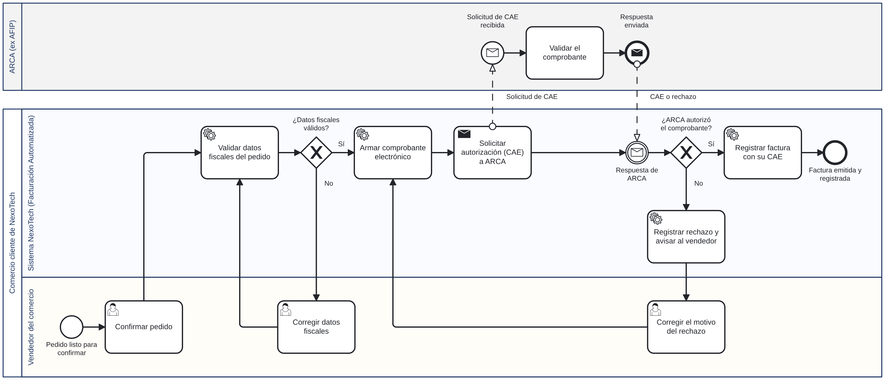

# NexoTech S.A. — Módulo de Facturación Automatizada

**Trabajo Práctico Integrador (TPI) de Organización Empresarial**
Tecnicatura Universitaria en Programación a Distancia (TUP AD) · Universidad Tecnológica Nacional (UTN)

Este repositorio reúne la documentación técnica del TPI, que desarrollé en cuatro entregas progresivas sobre un mismo caso de estudio. Las entregas 1, 2 y 3 ya fueron aprobadas; esta es la entrega final, que las integra y suma el modelado de procesos, el trabajo colaborativo con Git y GitHub, el tablero ágil y los mecanismos de control.

- 📋 **Tablero de gestión (GitHub Projects):** [ver tablero](https://github.com/users/FranCant/projects/2)

## Descripción del sistema

NexoTech S.A. es una empresa **ficticia** de desarrollo de software (sociedad anónima, sector cuaternario) cuyo producto es un sistema de gestión de pedidos tipo SaaS para comercios chicos y medianos. El proyecto que planifiqué a lo largo del TPI es un módulo nuevo, la **Facturación Automatizada**: apenas el comercio confirma un pedido, el sistema genera solo la factura electrónica, integrada con AFIP/ARCA, que la autoriza con un CAE (Código de Autorización Electrónico). Hoy esa factura se emite a mano, y eso genera demoras y errores de carga.

El objetivo general que definí en la Entrega 2 es desarrollar e implementar el módulo en un plazo máximo de 12 semanas, con cuatro metas cuantitativas: emisión en menos de 3 segundos desde que se confirma el pedido, al menos 10.000 facturas mensuales sin degradar el servicio (con capacidad de escalar a 50.000), desarrollo completo en 12 semanas como máximo y menos de 0,5 % de comprobantes rechazados por AFIP/ARCA.

> **Alcance:** el TPI trata sobre la organización, la planificación, la estructura, los datos y los procesos del proyecto. El repositorio no incluye código fuente del sistema, porque el módulo se planificó pero no se programó.

## Integrantes

| Nombre            | Rol                            | Comisión   |
| ----------------- | ------------------------------ | ---------- |
| Francisco Cantori | Autor del trabajo (individual) | Comisión 1 |

**Cátedra:** Prof. Gabriela Martínez (titular); Profs. Carolina Bruno, Mario Raúl López y Andrea Ramos (adjuntos).

## Contenido del repositorio

| Carpeta o archivo | Qué contiene                                                                                                                 |
| ----------------- | ---------------------------------------------------------------------------------------------------------------------------- |
| `README.md`       | Esta portada: descripción del sistema, proceso BPMN, historias de usuario, indicadores de control y Declaración de Uso de IA |
| `docs/bpmn/`      | Modelo BPMN del proceso: archivo `.bpmn` editable e imagen `.png`                                                            |
| `docs/entregas/`  | Las Entregas 1, 2 y 3 aprobadas, en PDF                                  |

## Recorrido del TPI

| Entrega | Tema                                     | Qué hice                                                                                                                      |
| ------- | ---------------------------------------- | ----------------------------------------------------------------------------------------------------------------------------- |
| 1       | La organización y su enfoque sistémico   | Analicé a NexoTech como sistema abierto y relevé la interdependencia entre sus módulos.                                       |
| 2       | Diagnóstico y planeación                 | FODA del proyecto, objetivo general, cuatro metas cuantitativas y Diagrama de Gantt.                                          |
| 3       | Estructura formal y diseño de datos      | Organigrama piramidal vertical normalizado y diccionario de datos con cuatro entidades (Cliente, Producto, Pedido y Factura). |
| 4       | Procesos, trabajo colaborativo y control | BPMN, repositorio en GitHub, tablero ágil e indicadores de control (esta entrega).                                            |

## Proceso de negocio (BPMN)

_Archivo editable: [`emision_factura_electronica.bpmn`](docs/bpmn/emision_factura_electronica.bpmn) (se abre en [bpmn.io](https://demo.bpmn.io/))._

El diagrama modela cómo se emite la factura de un pedido. Hay dos **pools**: el comercio cliente de NexoTech, dividido en dos **lanes** (el vendedor del comercio y el sistema automatizado de NexoTech), y ARCA, que participa como actor externo. El flujo estándar arranca cuando el vendedor confirma el pedido; el sistema valida los datos fiscales, arma el comprobante electrónico, le solicita la autorización (CAE) a ARCA y, cuando ARCA responde que lo autorizó, registra la factura con su CAE. Contemplé dos excepciones con compuertas exclusivas de decisión:

1. **¿Datos fiscales válidos?** Si no lo son, el vendedor corrige los datos fiscales y el sistema los vuelve a validar antes de armar el comprobante.
2. **¿ARCA autorizó el comprobante?** Si lo rechaza, el sistema registra el rechazo y avisa al vendedor, este corrige el motivo y el comprobante se arma y se envía de nuevo.

## Historias de usuario

Las tres historias están escritas en el formato "Como [usuario], quiero [funcionalidad], para [beneficio]". Cada una es un _issue_ de este repositorio, con sus criterios de aceptación, y su estado (Por Hacer, En Progreso, Listo) se sigue en el [tablero](https://github.com/users/FranCant/projects/2).

| ID    | Historia                                                                                                                                                                                                 | Indicador asociado |
| ----- | -------------------------------------------------------------------------------------------------------------------------------------------------------------------------------------------------------- | ------------------ |
| HU-01 | Como comerciante que usa NexoTech, quiero que la factura electrónica se emita sola cuando confirmo un pedido, para no tener que emitirla a mano.                                                         | IC-01              |
| HU-02 | Como comerciante que usa NexoTech, quiero ver el estado de cada factura y recibir un aviso cuando ARCA la rechaza, para corregir el problema a tiempo y no quedarme sin comprobante.                     | IC-02              |
| HU-03 | Como responsable de Finanzas y Control de NexoTech, quiero que cada comprobante quede generado y registrado en el momento, para agilizar la conciliación contable sin tener que cargarlo después a mano. | IC-01              |

**Qué significa "Listo" en este proyecto.** El módulo se planificó pero no se programó, así que una historia pasa a _Listo_ cuando está definida y modelada, no cuando está implementada. Para eso tiene que cumplir cuatro condiciones:

1. Está escrita en el formato formal "Como..., quiero..., para...".
2. Tiene criterios de aceptación que se pueden verificar.
3. Está representada en el diagrama BPMN y vinculada a las entidades del diccionario de datos de la Entrega 3.
4. Tiene al menos un indicador de control asociado.

## Indicadores de control y estándares de desempeño

Para esta parte me apoyé en las cuatro etapas del control que vimos en la Unidad 4: **establecer estándares, medir, corregir y retroalimentar**. Los estándares no los inventé de cero: son las cuatro metas cuantitativas que fijé en la Entrega 2.

| Código | Indicador                 | Estándar (meta de la Entrega 2)                                                                    | Cómo se mide                                                                                            | Acción correctiva si no se cumple                                                          |
| ------ | ------------------------- | -------------------------------------------------------------------------------------------------- | ------------------------------------------------------------------------------------------------------- | ------------------------------------------------------------------------------------------ |
| IC-01  | Tiempo de emisión         | No superar los 3 segundos desde que se confirma el pedido                                          | Tiempo entre la confirmación del pedido y el registro de la factura con su CAE                          | Revisar la llamada al servicio de ARCA y las tareas previas al envío                       |
| IC-02  | Tasa de rechazo de ARCA   | Por debajo del 0,5 % del total emitido                                                             | Comprobantes rechazados ÷ comprobantes enviados × 100, a partir de los rechazos que el sistema registra | Analizar los motivos de rechazo y reforzar la validación de datos fiscales antes del envío |
| IC-03  | Volumen mensual procesado | Al menos 10.000 facturas mensuales sin degradación del servicio, con capacidad de escalar a 50.000 | Facturas emitidas en el mes y comportamiento del servicio                                               | Escalar la infraestructura cloud antes de llegar al límite                                 |
| IC-04  | Plazo de desarrollo       | Completar el desarrollo en un máximo de 12 semanas                                                 | Semanas de desvío respecto del Diagrama de Gantt de la Entrega 2                                        | Reasignar tareas o replanificar los hitos restantes                                        |

Se considera desvío cualquier resultado que no cumpla el estándar. Así se aplican las cuatro etapas:

1. **Establecer estándares.** Cada indicador corresponde a una meta de la Entrega 2: tiempo de respuesta (IC-01), calidad (IC-02), escalabilidad (IC-03) y plazos (IC-04).
2. **Medir.** Los datos salen del propio sistema (fecha y hora del pedido y de la factura, registro de rechazos, conteo de facturas emitidas) y, para el plazo, del Diagrama de Gantt.
3. **Corregir.** Si un indicador no cumple el estándar, se aplica la acción correctiva de la tabla.
4. **Retroalimentar.** Los resultados vuelven a la planificación: si una meta no se cumple, se revisa el diseño del proceso (por ejemplo, la validación de datos fiscales que figura en el BPMN) antes de seguir sumando funciones.

Los indicadores se pueden ubicar en el [diagrama BPMN](docs/bpmn/emision_factura_electronica.png): el IC-01 mide el tramo que va desde "Confirmar pedido" hasta "Registrar factura con su CAE", y el IC-02 se alimenta de la salida "No" de la compuerta "¿ARCA autorizó el comprobante?".

## Cómo trabajé en el repositorio

- **Ramas:** `main` guarda la versión estable que se entrega; `develop` integra el trabajo; cada tarea tiene su rama `feature/...` (por ejemplo `feature/bpmn`).
- **Commits:** mensajes cortos en formato `tipo: descripción`, con los tipos `docs`, `feat`, `fix` y `chore` (por ejemplo, `docs: agregar diagrama BPMN del proceso de facturación`).
- **Pull Requests:** cada rama `feature/...` se integra a `develop` mediante un Pull Request, y `develop` pasa a `main` con otro.
- **Tablero:** cada historia de usuario es un _issue_ del repositorio y se mueve entre las columnas del tablero a medida que avanza.

## Declaración de Uso de IA

Usé **Claude** (Anthropic) como asistente a lo largo de todo el TPI. Lo usé como apoyo para ordenar, dibujar y redactar borradores, pero las decisiones sobre el caso, la revisión contra el material de la cátedra y la corrección de errores las hice yo. Asumo la responsabilidad por la veracidad y la coherencia de todo lo que presento, incluso lo que salió del asistente.

### Para qué la usé

- Ordenar cada entrega según la plantilla de la cátedra y armar los documentos en Word.
- Dibujar los diagramas a partir de la información que yo definía: interdependencia de módulos, FODA, Gantt y organigrama. En esta entrega, el modelo BPMN.
- Redactar borradores de las historias de usuario, los indicadores de control y este README, que después revisé y ajusté.
- Explicarme las consignas y compararlas con el material de la cátedra (Unidades 1 a 5 y la guía de Git y GitHub).
- Guiarme paso a paso en el uso de Git y GitHub.
